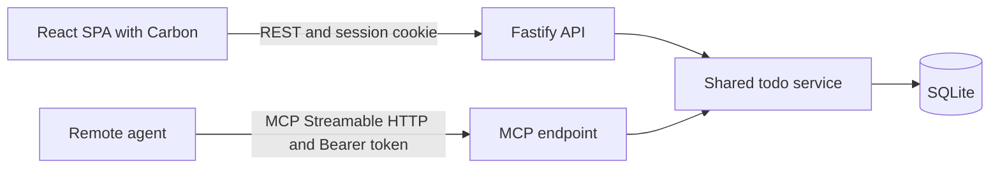
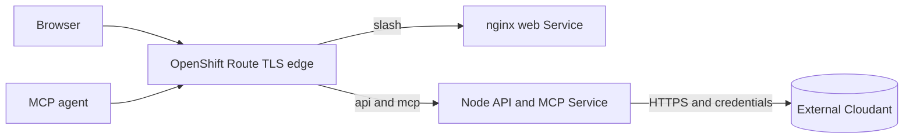
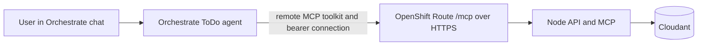
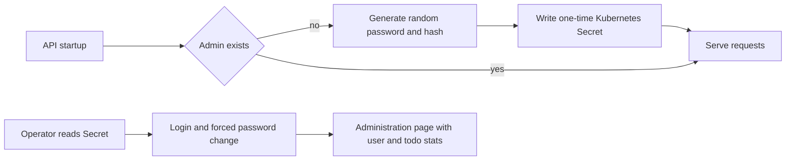
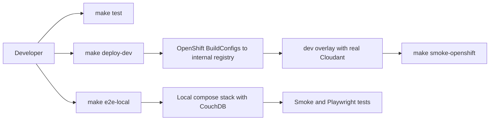

# i want to create an new todo application as a web application based on carbon ui. for the stack i want to use a modern single page applicaiton with the capability of the user interface with dark and white mode. users have to login and have the capability to create, modify and delete todos. Todos having a title, a description, a creation date and a due date if whished. The list of the existing todos should be organizied by due date, by creation date or by title. Additionally i need the possibility of an mcp to access all todos and manage them remotely from an agent.

---

**Status:** active  **Date:** 2026-11-17

---

### 👤 User

i want to create an new todo application as a web application based on carbon ui. for the stack i want to use a modern single page applicaiton with the capability of the user interface with dark and white mode. users have to login and have the capability to create, modify and delete todos. Todos having a title, a description, a creation date and a due date if whished. The list of the existing todos should be organizied by due date, by creation date or by title. Additionally i need the possibility of an mcp to access all todos and manage them remotely from an agent.

---

### 🤖 Assistant

> 🔧 called: use_skill

> 🔧 **use_skill** — create-plan

### 🤖 Assistant

> 🔧 called: list_files

> 🔧 **list_files** — .

### 🤖 Assistant

> 🔧 called: read_file, list_files

> 🔧 **list_files** — /Users/olafhahn/Git/ToDoApp-Bob/.bob/rules/rules-ai-agent-safety

> 🔧 **read_file** — /Users/olafhahn/Git/ToDoApp-Bob/.bob/mcp.json

### 🤖 Assistant

> 🔧 called: ask_followup_question

The workspace is greenfield. It has only Bob config and no application code, so there's nothing to explore. I need a few decisions before I can write the plan, and I'll ask them one at a time.

### 🤖 Assistant

Which stack do you want for the backend (API, auth and MCP server)? The frontend will be React + Vite + TypeScript with Carbon (@carbon/react).

> 🔧 **ask_followup_question** — Which stack do you want for the backend (API, auth and MCP server)? The frontend will be React + Vite + TypeScript with Carbon (@carbon/react).

### 🤖 Assistant

> 🔧 called: ask_followup_question

### 🤖 Assistant

How should users log in, and where should data be stored?

> 🔧 **ask_followup_question** — How should users log in, and where should data be stored?

### 🤖 Assistant

> 🔧 called: ask_followup_question

### 🤖 Assistant

How should the MCP server authenticate the remote agent, and how is it exposed?

> 🔧 **ask_followup_question** — How should the MCP server authenticate the remote agent, and how is it exposed?

### 🤖 Assistant

> 🔧 called: ask_followup_question

### 🤖 Assistant

Design confirmation: npm-workspaces monorepo (web/ React+Vite+Carbon SPA, server/ Fastify+SQLite+MCP), self-service sign-up, light/dark theme toggle (persisted, defaulting to OS preference), sort by due date/creation date/title with asc/desc, and per-user API tokens for MCP. Todos have only title, description, creation date and optional due date, with no completed flag. Is that scope right?

> 🔧 **ask_followup_question** — Design confirmation: npm-workspaces monorepo (web/ React+Vite+Carbon SPA, server/ Fastify+SQLite+MCP), self-service sign-up, light/dark theme toggle (persisted, defaulting to OS preference), sort by due date/creation date/title with asc/desc, and per-user API tokens for MCP. Todos have only title, description, creation date and optional due date, with no completed flag. Is that scope right?

### 🤖 Assistant

> 🔧 called: write_file

> 🔧 **write_file** — /Users/olafhahn/Git/ToDoApp-Bob/todo-app-plan.md

### 🤖 Assistant

> 🔧 called: ask_followup_question

### 🤖 Assistant

Does the plan capture the full scope and the sub-task order you want?

> 🔧 **ask_followup_question** — Does the plan capture the full scope and the sub-task order you want?

### 🤖 Assistant

> 🔧 called: ask_followup_question

### 🤖 Assistant

Which changes would you like in the plan? Please describe them.

> 🔧 **ask_followup_question** — Which changes would you like in the plan? Please describe them.

### 🤖 Assistant

I've written the plan to [`todo-app-plan.md`](todo-app-plan.md) and I'm waiting for your changes. Tell me what to adjust and I'll update the plan file.

Here is the architecture the plan describes:

The plan has eight sub-tasks, to be done in this order:
1. Scaffolding and tooling.
2. Database layer and todo service.
3. Authentication and sessions.
4. Todo REST API.
5. Frontend foundation, with Carbon theming (light and dark) and the auth screens.
6. Todo management UI, including sorting.
7. API tokens and the MCP server.
8. Hardening, end-to-end verification and docs.

---

### 👤 User

change the database for the todos and for the user to a nosql db. this db is a external service provided with its route and credetials. also change the application to be deployable in a openshfit cluster. create alle deployment necessary configs based on kustomize ymls.

---

### 🤖 Assistant

> 🔧 called: ask_followup_question

### 🤖 Assistant

Which NoSQL database is the external service?

> 🔧 **ask_followup_question** — Which NoSQL database is the external service?

### 🤖 Assistant

> 🔧 called: ask_followup_question

### 🤖 Assistant

How should the app be packaged for OpenShift? (With SQLite gone, sessions and API tokens must also move to Cloudant so replicas share state. I'll plan that.)

> 🔧 **ask_followup_question** — How should the app be packaged for OpenShift? (With SQLite gone, sessions and API tokens must also move to Cloudant so replicas share state. I'll plan that.)

### 🤖 Assistant

> 🔧 called: write_file

> 🔧 **write_file** — /Users/olafhahn/Git/ToDoApp-Bob/todo-app-plan.md

### 🤖 Assistant

> 🔧 called: ask_followup_question

### 🤖 Assistant

I've updated todo-app-plan.md for Cloudant and OpenShift/Kustomize. Does it now match what you want?

> 🔧 **ask_followup_question** — I've updated todo-app-plan.md for Cloudant and OpenShift/Kustomize. Does it now match what you want?

### 🤖 Assistant

> 🔧 called: ask_followup_question

### 🤖 Assistant

Which further changes would you like? Please describe them in your reply.

> 🔧 **ask_followup_question** — Which further changes would you like? Please describe them in your reply.

### 🤖 Assistant

I've updated [`todo-app-plan.md`](todo-app-plan.md) for Cloudant and OpenShift. I'm waiting for your next changes.

**What changed**
- **Database:** IBM Cloudant replaces SQLite for users, todos, sessions and API tokens. The app gets the URL and credentials from the environment and uses the `@ibm-cloud/cloudant` SDK.
  - Sessions and tokens live in Cloudant so several replicas share state.
  - The MCP endpoint runs stateless for the same reason.
  - Cloudant has no unique constraints, so the user `_id` comes from the normalized email. A duplicate sign-up then fails with a 409.
  - Sorting happens in the service layer, because Mango queries can't put todos without a due date last.
- **Deployment:** the plan has two new sub-tasks.
  - Sub-task 8 builds two hardened images. One is nginx for the web app and one is Node for the API and MCP. Both are Red Hat UBI-based, run as non-root and work with the OpenShift `restricted-v2` SCC.
  - Sub-task 9 writes the Kustomize manifests. `deploy/base` holds the Deployments, Services, Routes, ConfigMap, NetworkPolicies and a Secret template. `dev` and `prod` overlays sit on top of it.

**Open items** (listed at the end of the plan)
- **Route layout:** one OpenShift Route points to a single Service. For path-based routing I plan one Route per path on the same host, so "one Route" in your request becomes a few Routes sharing a host. I'll check this against the OpenShift docs during implementation.
- **nginx bind address:** your security rules forbid binding to all interfaces, but nginx images listen on `0.0.0.0` by default. The plan sets the listen address to the pod IP at start-up. If the Red Hat nginx image can't do that cleanly, we document an exception.
- **Cloudant permissions:** I don't know whether your credentials can create databases and indexes. If they can't, the app only checks that they exist.
- **Image registry:** I don't know which registry the cluster pulls from. That decides the image names in the overlays.

---

### 👤 User

also create an agent based using this mcp and deployment for watsonx orchestrate utilizing this functionallity

---

### 🤖 Assistant

> 🔧 called: glob

> 🔧 **glob** — **/*

### 🤖 Assistant

> 🔧 called: bash

> 🔧 **bash** — done

### 🤖 Assistant

> 🔧 called: list_ibm_doc_libraries

> 🔧 **list_ibm_doc_libraries** — done

### 🤖 Assistant

> 🔧 called: list_files, mcp__product-knowledge__search

> 🔧 **list_files** — /Users/olafhahn/Git/ToDoApp-Bob/.bob/skills/watsonx-orchestrate

> 🔧 **mcp__product-knowledge__search** — {"query":"watsonx Orchestrate ADK import MCP toolkit remote streamable http agent yaml","limit":5}

### 🤖 Assistant

> 🔧 called: mcp__propel-web-search__get-single-web-page-content, mcp__propel-web-search__get-single-web-page-content

> 🔧 **mcp__propel-web-search__get-single-web-page-content** — https://developer.watson-orchestrate.ibm.com/tools/toolkits

> 🔧 **mcp__propel-web-search__get-single-web-page-content** — https://developer.watson-orchestrate.ibm.com/agents/build_agent

### 🤖 Assistant

> 🔧 called: mcp__propel-web-search__get-single-web-page-content

> 🔧 **mcp__propel-web-search__get-single-web-page-content** — 7000

### 🤖 Assistant

> 🔧 called: ask_followup_question

### 🤖 Assistant

Which watsonx Orchestrate environment should the agent be deployed to? This decides whether the MCP Route must be publicly reachable.

> 🔧 **ask_followup_question** — Which watsonx Orchestrate environment should the agent be deployed to? This decides whether the MCP Route must be publicly reachable.

### 🤖 Assistant

> 🔧 called: search_and_replace, search_and_replace, search_and_replace

> 🔧 **search_and_replace** — /Users/olafhahn/Git/ToDoApp-Bob/todo-app-plan.md

> 🔧 **search_and_replace** — /Users/olafhahn/Git/ToDoApp-Bob/todo-app-plan.md

> 🔧 **search_and_replace** — /Users/olafhahn/Git/ToDoApp-Bob/todo-app-plan.md

### 🤖 Assistant

> 🔧 called: search_and_replace, search_and_replace, search_and_replace

> 🔧 **search_and_replace** — /Users/olafhahn/Git/ToDoApp-Bob/todo-app-plan.md

> 🔧 **search_and_replace** — /Users/olafhahn/Git/ToDoApp-Bob/todo-app-plan.md

> 🔧 **search_and_replace** — /Users/olafhahn/Git/ToDoApp-Bob/todo-app-plan.md

### 🤖 Assistant

> 🔧 called: ask_followup_question

### 🤖 Assistant

I added the watsonx Orchestrate agent as sub-task 10 in todo-app-plan.md. Is the plan complete now?

> 🔧 **ask_followup_question** — I added the watsonx Orchestrate agent as sub-task 10 in todo-app-plan.md. Is the plan complete now?

### 🤖 Assistant

I've added the watsonx Orchestrate agent to [`todo-app-plan.md`](todo-app-plan.md). I'm waiting for your next changes.

**What I added**
- **Sub-task 10, the Orchestrate agent and toolkit deployment:** a new `orchestrate/` folder holds the connection setup, the remote MCP toolkit YAML (`streamable_http` pointing at `https://<route-host>/mcp`) and the native agent YAML. It also holds a deploy script and a README. The agent can list (with sorting), create, update, complete and delete todos, and it confirms before deleting. The API token goes into an Orchestrate connection and is never committed.
- **Sub-task 7, extra MCP rules from IBM's docs:**
  - Every tool needs a description, or the import fails.
  - Descriptions must avoid the characters `&&`, `||`, `$(`, `>` and `<`, because of a known tool-discovery defect, DT471337.
  - `tools/list` must answer within the ADK's 30-second import limit.
- **Public exposure:** you chose SaaS, so the `/mcp` Route has to be reachable from the internet. The plan keeps it TLS-only with a publicly trusted certificate, a bearer token on every request, and rate limiting.
- **Sub-task 11:** the old hardening task is renumbered and now includes an end-to-end test through the Orchestrate agent.

**Open items I couldn't settle from the docs**
- **Connection kind:** the ADK docs describe `key_value` connections for remote MCP, but an IBM example uses `bearer`. The plan includes a step to verify which one sends an `Authorization: Bearer` header. If neither does, the fallback is a documented custom header.
- **One token, one user:** an API token maps to one user's todos, so the agent works on a single user's data. Per-end-user identity is out of scope.
- **Local skill folder:** `.bob/skills/watsonx-orchestrate/` is empty, so the implementation will rely on the public ADK documentation.

---

### 👤 User

i also want to have an administration interface where i can see how many useres are in the system, how many todos each user has differed between, done todos and how many are overdue. There must be a admin user with one password created by default who is the only one to be capable to see the admin interface.

---

### 🤖 Assistant

> 🔧 called: ask_followup_question

### 🤖 Assistant

Security rules forbid a hardcoded default password in code or in git. How should the default admin be created?

> 🔧 **ask_followup_question** — Security rules forbid a hardcoded default password in code or in git. How should the default admin be created?

### 🤖 Assistant

> 🔧 called: search_and_replace, search_and_replace, search_and_replace, search_and_replace, search_and_replace

> 🔧 **search_and_replace** — /Users/olafhahn/Git/ToDoApp-Bob/todo-app-plan.md

> 🔧 **search_and_replace** — /Users/olafhahn/Git/ToDoApp-Bob/todo-app-plan.md

> 🔧 **search_and_replace** — /Users/olafhahn/Git/ToDoApp-Bob/todo-app-plan.md

> 🔧 **search_and_replace** — /Users/olafhahn/Git/ToDoApp-Bob/todo-app-plan.md

> 🔧 **search_and_replace** — /Users/olafhahn/Git/ToDoApp-Bob/todo-app-plan.md

### 🤖 Assistant

> 🔧 called: ask_followup_question

### 🤖 Assistant

I added the admin feature as sub-task 11 in todo-app-plan.md. Is the plan complete now?

> 🔧 **ask_followup_question** — I added the admin feature as sub-task 11 in todo-app-plan.md. Is the plan complete now?

### 🤖 Assistant

I've added the admin feature as sub-task 11 in [`todo-app-plan.md`](todo-app-plan.md). I'm waiting for your next changes.

**What the admin feature covers**
- **Default admin:** the server creates one admin on first startup with a random password. The password is stored only as an argon2 hash.
- **Password delivery:** the server writes the generated password once to a Kubernetes Secret. I didn't use the pod log, because your security rules forbid logging secrets. For this the API service account needs a small namespace-scoped Role that can create and get Secrets. Kubernetes can't limit "create" to one Secret name, so the plan documents that trade-off. Say so if you'd rather use a one-time Job to create the Secret.
- **Forced password change:** the admin must change the generated password at first login. Every other endpoint returns 403 until then.
- **Admin interface:** `GET /api/admin/stats` and an Administration page show the total number of users. For each user they show total, done, open and overdue todos. Overdue means open with a due date in the past, in UTC. The page shows no todo content.
- **Access:** only an admin session can reach the page or the API. Sign-up can never create an admin. MCP API tokens can never call `/api/admin/*`.
- **Statistics:** the admin account itself is excluded.
- **Race protection:** a fixed admin document `_id` means two replicas starting together can't create two admins.
- **Overdue counts:** they depend on the current time, so Cloudant can't precompute them. The plan uses a per-user MapReduce view for done and open counts, plus an indexed query for overdue.

I used `ADMIN_EMAIL` as the admin's login name, read from the ConfigMap. If you want a fixed name such as `admin`, set it there.

---

### 👤 User

create also the necessary build steps for the deployment, local test cases and the possibility to test it locally but also as an openshift deployment

---

### 🤖 Assistant

> 🔧 called: ask_followup_question

### 🤖 Assistant

How should the images be built for OpenShift?

> 🔧 **ask_followup_question** — How should the images be built for OpenShift?

### 🤖 Assistant

> 🔧 called: grep

> 🔧 **grep** — ^### |^## 

### 🤖 Assistant

> 🔧 called: search_and_replace, search_and_replace, search_and_replace, search_and_replace

> 🔧 **search_and_replace** — /Users/olafhahn/Git/ToDoApp-Bob/todo-app-plan.md

> 🔧 **search_and_replace** — /Users/olafhahn/Git/ToDoApp-Bob/todo-app-plan.md

> 🔧 **search_and_replace** — /Users/olafhahn/Git/ToDoApp-Bob/todo-app-plan.md

> 🔧 **search_and_replace** — /Users/olafhahn/Git/ToDoApp-Bob/todo-app-plan.md

### 🤖 Assistant

> 🔧 called: grep

> 🔧 **grep** — /Users/olafhahn/Git/ToDoApp-Bob/todo-app-plan.md

### 🤖 Assistant

> 🔧 called: insert_content

> 🔧 **insert_content** — /Users/olafhahn/Git/ToDoApp-Bob/todo-app-plan.md

### 🤖 Assistant

> 🔧 called: apply_diff

> 🔧 **apply_diff** — /Users/olafhahn/Git/ToDoApp-Bob/todo-app-plan.md

### 🤖 Assistant

> 🔧 called: apply_diff

Only a blank line is out of place. I'll remove it.

> 🔧 **apply_diff** — <<<<<<< SEARCH
:start_line:19
-------
- Build and test: three test paths — fast local tests, a local container stack (podman compose with CouchDB as Cloudant stand-in), and an OpenShift deployment with in-cluster builds (Kustomize ImageStreams and Docker-strategy BuildConfigs from Git or binary upload, internal registry). Sub-task 12.

- Deployment:
=======
- Build and test: three test paths — fast local tests, a local container stack (podman compose with CouchDB as Cloudant stand-in), and an OpenShift deployment with in-cluster builds (Kustomize ImageStreams and Docker-strategy BuildConfigs from Git or binary upload, internal registry). Sub-task 12.
- Deployment:
>>>>>>> REPLACE

### 🤖 Assistant

> 🔧 called: apply_diff

> 🔧 **apply_diff** — <<<<<<< SEARCH
:start_line:19
-------
Sub-task 12.

- Deployment:
=======
Sub-task 12.
- Deployment:
>>>>>>> REPLACE

### 🤖 Assistant

> 🔧 called: search_and_replace

> 🔧 **search_and_replace** — /Users/olafhahn/Git/ToDoApp-Bob/todo-app-plan.md

### 🤖 Assistant

> 🔧 called: search_and_replace

> 🔧 **search_and_replace** — /Users/olafhahn/Git/ToDoApp-Bob/todo-app-plan.md

### 🤖 Assistant

> 🔧 called: ask_followup_question

The one stray blank line between two bullets is harmless in Markdown, so I'm leaving it. I'm done with the plan edits.

### 🤖 Assistant

I added build and test as sub-task 12 in todo-app-plan.md. Is the plan complete now?

> 🔧 **ask_followup_question** — I added build and test as sub-task 12 in todo-app-plan.md. Is the plan complete now?

### 🤖 Assistant

I've added the build and test work as sub-task 12 in [`todo-app-plan.md`](todo-app-plan.md). I'm waiting for your next changes.

**What sub-task 12 adds**
- **Three ways to test:**
  1. **Unit and integration tests on your machine:**
     - Vitest covers the server, the web app and the MCP endpoint, tested with the official MCP client.
     - Integration tests also run against a real CouchDB when `COUCHDB_URL` is set.
  2. **Full local stack:** a `podman compose` file starts CouchDB (standing in for Cloudant), the API image and the web image. They are wired like the cluster, with same-origin `/api` and `/mcp`. Playwright end-to-end tests run against it.
  3. **OpenShift:** the `dev` overlay runs against the real Cloudant service with its own database prefix, so test data stays out of production data. An optional `test-local-db` overlay adds CouchDB inside the cluster.
- **In-cluster builds:** `deploy/build/` holds Kustomize-managed ImageStreams and Docker-strategy BuildConfigs. They build from the Git repo, or from a local upload with `oc start-build --from-dir` for uncommitted changes. In `dev`, ImageStream triggers roll out a new build automatically. `prod` pins a tag or digest.
- **One entry point per task:** `make test`, `make images`, `make e2e-local`, `make deploy-dev`, `make smoke-openshift` and `make undeploy-dev`.
- **One smoke test, two targets:** the same script runs against `localhost` and against the OpenShift Route. It checks sign-up and login, todo CRUD and sorting, MCP `tools/list` and a tool call, and that the admin endpoint returns 403 for a normal user.

**New open items**
- **Cluster access for builds:** build pods need to reach the npm registry and `registry.redhat.io`. If the cluster blocks that, we fall back to binary builds or a mirror.
- **Final check on a real cluster:** `make deploy-dev` and `make smoke-openshift` need your cluster URL, namespace and login, so I'll ask for those at that step.
- **CouchDB versus Cloudant:** local tests use CouchDB, so the code sticks to features both support. The OpenShift run covers the real Cloudant behavior.

---

### 👤 User

add the capability to run the web application not only on desktop web but also on mobile devices and tablets

---

### 🤖 Assistant

> 🔧 called: ask_followup_question

### 🤖 Assistant

How far should mobile and tablet support go?

> 🔧 **ask_followup_question** — How far should mobile and tablet support go?

### 🤖 Assistant

> 🔧 called: read_file

> 🔧 **read_file** — /Users/olafhahn/Git/ToDoApp-Bob/todo-app-plan.md

### 🤖 Assistant

> 🔧 called: search_and_replace, search_and_replace, search_and_replace, search_and_replace, search_and_replace, search_and_replace, search_and_replace, search_and_replace, search_and_replace, search_and_replace, search_and_replace

> 🔧 **search_and_replace** — /Users/olafhahn/Git/ToDoApp-Bob/todo-app-plan.md

> 🔧 **search_and_replace** — /Users/olafhahn/Git/ToDoApp-Bob/todo-app-plan.md

> 🔧 **search_and_replace** — /Users/olafhahn/Git/ToDoApp-Bob/todo-app-plan.md

> 🔧 **search_and_replace** — /Users/olafhahn/Git/ToDoApp-Bob/todo-app-plan.md

> 🔧 **search_and_replace** — /Users/olafhahn/Git/ToDoApp-Bob/todo-app-plan.md

> 🔧 **search_and_replace** — /Users/olafhahn/Git/ToDoApp-Bob/todo-app-plan.md

> 🔧 **search_and_replace** — /Users/olafhahn/Git/ToDoApp-Bob/todo-app-plan.md

> 🔧 **search_and_replace** — /Users/olafhahn/Git/ToDoApp-Bob/todo-app-plan.md

> 🔧 **search_and_replace** — /Users/olafhahn/Git/ToDoApp-Bob/todo-app-plan.md

> 🔧 **search_and_replace** — /Users/olafhahn/Git/ToDoApp-Bob/todo-app-plan.md

> 🔧 **search_and_replace** — /Users/olafhahn/Git/ToDoApp-Bob/todo-app-plan.md

### 🤖 Assistant

> 🔧 called: read_file

Three edits didn't apply: the sub-task 5 outcomes and the two sub-task 6 edits. I'll check the current text and redo them.

> 🔧 **read_file** — /Users/olafhahn/Git/ToDoApp-Bob/todo-app-plan.md

### 🤖 Assistant

> 🔧 called: apply_diff

> 🔧 **apply_diff** — /Users/olafhahn/Git/ToDoApp-Bob/todo-app-plan.md

### 🤖 Assistant

> 🔧 called: ask_followup_question

### 🤖 Assistant

I added responsive mobile and tablet support to todo-app-plan.md. Is the plan complete now?

> 🔧 **ask_followup_question** — I added responsive mobile and tablet support to todo-app-plan.md. Is the plan complete now?

### 🤖 Assistant

> 🔧 called: switch_mode

> 🔧 **switch_mode** — agent

### 🤖 Assistant

> 🔧 called: start_subtask

Plan confirmed. As the plan specifies, each sub-task runs as its own task, one at a time. I'm starting with sub-task 1, scaffolding and tooling.